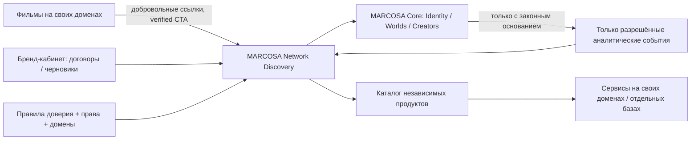

# MARCOSA FUSION R1 — MASTER STRATEGY / 2026–2028

**Дата архитектурного среза:** 22 октября 2026. **Приоритет:** сохранить действующую MARCOSA, подключить подтверждённые собственные продукты и конвертировать интерес зрителей в добровольное полезное действие. **Ограничение:** статический исходный архив ≠ дамп БД, доступ к серверу или подтверждённый production.

## 1. Executive Summary

**MARCOSA — цифровые Worlds, связанные с независимыми историями, авторами и продуктами.** Для нового зрителя причина прийти простая: интересная интерактивная история, а после неё — осмысленное продолжение в тематическом World, другой истории или полезном продукте. Для автора — портативный цифровой дом и каналы привлечения аудитории. Для бренда — прозрачное спонсорство и создание интерактивной истории, а не покупка недостоверных показов.

**Не делаем:** ещё одну отдельную социальную сеть, централизованный склад чужих баз данных, фиктивную рекламную биржу, токеномическую систему, коллективный сбор персональных данных без правового основания или резкую миграцию 43 сайтов.

**Делаем сейчас:** аккуратно надстраиваем Discovery/Network OS поверх MARCOSA; инвентаризируем код, права и домены; начинаем с одного работающего сценария «фильм → продолжение → World/проект»; продаём услуги производства брендированных интерактивных историй после портфолио-кейсов, а не неизвестный охват.

**Текущий разработанный выпуск R1:** исходные 70 файлов MARCOSA сохранены; в `site/index.html` добавлены три независимые точки входа в Network OS; доступны RU/EN/中文 каталог 16 исходно подтверждённых продуктов, фильтры, поиск, 43 пустых слота для инвентаризации, инструмент локальной подготовки A/B креативов с выгрузкой JSON. Не добавлялись серверные платежи, фейковые пользователи, авторизация и показная статистика.

**Единственная первичная проверяемая гипотеза:** зритель, завершивший релевантную историю, добровольно переходит к тематическому продолжению и видит пользу. Только после подтверждения этого сценария запускать более сложные коммерческие функции.

**Решение:** INVEST в сохранение базового ядра и интерактивный каталог; VALIDATE реальную конверсию из трёх фильмов; MAINTAIN независимые B2B-кодовые базы; HOLD новые дорогие домены, платёжную рекламную биржу, авто-ставки и алгоритмический «репутационный депозит».

## 2. Аудит настоящей MARCOSA из переданного архива

**Проверено в архиве:** `index.html`, `world-home.js/css`, `nexus.js/css`, `marcosa-supabase.js`, `marcosa-config.js`, модули сообщений, импорта, модерации, событий, приглашений, голосовых комнат, мини-приложений, разработки и четырёх миграций Supabase по устройствам/ключам/удалению аккаунта. Сохранены `PRODUCT_BRIEF.md`, `MARCOSA_PRODUCT_BIBLE.md`, `BRIEF_AUDIT.md` и `PRODUCTION_EVIDENCE.md`. Последний документ **заявляет** production-проверки — это самоотчёт внутри архива, не независимая проверка нами.

| Компонент | Есть в файлах | Что доказано этим срезом | Не подтверждено / следующий тест |
|---|---|---|---|
| Главная / Moments / Discover | HTML, JS, CSS, локальные примеры | Элементы и обработчики есть | Реальная конверсия, подлинность лайков/просмотров и данные живого сервера |
| Worlds / профили | World UI, Supabase-клиент | Есть клиентские пути и формы | Права RLS по каждой роли, полные миграции, реальные пользователи |
| Messages / E2EE | Client messages + AES-GCM helpers | Есть клиентский код | Серверный многоустройственный обмен ключами, recovery, угрозы |
| Live rooms / Events | UI и модули | Возможности прототипированы | Масштаб WebRTC, согласия, надёжное событие/RSVP |
| Creator Hub / публикации | Интерфейс и клиентские адаптеры | Присутствуют | Экономика и реальный retention, подтверждение публикаций |
| Brand Workspace / Market | Диалог и часть адаптеров | Контур демо есть | Оплаты выключены, коммерческая инфраструктура и договоры отсутствуют в поставке |
| Developer platform | SDK, sandbox, JSON-схемы | Прототипируемый реестр мини-приложений | Серверная регистрация/подпись/ревокация/фильтрация в production |
| AI | `marcosa-ai.js`, пустой endpoint в конфигурации | Локальный fallback и границы | Действительный AI-сервис и unit economics не подтверждены |
| Supabase | Публичная runtime-конфигурация, 4 SQL-миграции, клиент | Есть интеграционный слой | Полный SQL schema dump, проекты Storage, реальные RLS, backups, журналы, secrets |
| Deploy / инфраструктура | Файлы статической сборки, PowerShell верификаторы | Доступен static build snapshot | Сборочный pipeline, серверный операторский API, детальный деплой этого release |

**Обязательное действие владельца:** на сервере отдельно получить **структуру** БД, список функций, RLS-политик, Storage buckets, конфигурацию reverse proxy и CI — без передачи секретов в чат. Сверить живой HTML/JS hash с этим архивом. До этого **нельзя** безопасно заменить production «полной новой версией».

## 3. Аудит 43 кино-сайтов

В пакете нет проверенных публичных доменов 43 фильмов. Создана заготовка `inventory/film-sites.csv` с `FILM-01…FILM-43` и пустыми полями; **не** подтверждено существование 43 работающих сайтов. Статус каждого: `unverified_missing_domain`.

Для каждого фильма фиксируем: URL, владелец/права, сценарий, финал, язык, формат, Web Vitals, мобильный UX, доступность, наличие CTA, аналитика, ссылки на MARCOSA, режим рекламы, цена интеграции, заметка по безопасности. В следующей волне рейтингуем: контент × техническая готовность × права × подходящий World × цена изменений; непроверенные пункты не оцениваются числом.

**Пилот:** взять 3 реально доступных домена с максимально разными тематиками, небольшим техническим долгом и понятным тематическим продолжением. Продвижение только после осознанного выбора или финала; в обычных сценах — без рекламных вторжений.

## 4. Карта продукта

**Ядро MARCOSA (не переносить в микросервисы):** Identity, Personal Worlds, Worlds, Rooms, Content, Events, Social Graph, Privacy, Moderation, Notifications, Profiles, Creator Hub.

**Надстройка Network OS:** проверяемый каталог независимых проектов и фильмов, гайд по World/истории, контекстные рекомендации, управление первичной рекламой собственных продуктов, атрибуция *без идентификации зрителя* по техническим запросам, добровольные заявки, отчётность и аудит допуска площадок.

**Независимые бизнес-приложения:** AdOS, IMPOSSIBLE AI, IntentGraph, IntentMesh, KVALORA, OpsPilot, OutcomeMesh, ProofOS, SIGNAL WORLDS, TIMELESS, UNIVERSA WORK, WAITOS и четыре проекта из подключённого GitHub. Их исходные базы, серверы и платежи не смешиваются. См. `inventory/projects.json`.

**Гильдии и цифровые поместья:** отдельные World-объекты с переносимым контентом, правилами, приглашениями, прозрачным распределением договорной выручки. Гильдия — добровольный союз авторов. Никаких автоматических финансовых санкций и «депозитов репутации» без доказательств, договора, апелляции и юридического анализа.

## 5. Архитектура

Принцип: один источник правды **для каждого типа данных**, без копирования лишних профилей. MARCOSA хранит пользователи/Worlds/подписки; независимый сайт хранит собственный фильм и контент; Network OS — публичный реестр, проверку прав/URL/статуса, метаданные CTA и агрегированные счётчики при допустимом правовом основании.

**Сейчас реализовано только статическое представление этого контракта.** Для production нужны серверный API, operator IAM, миграции, права, резервные копии, мониторинг, TLS и проверка всех внешних ссылок.

## 6. MVP: критерии приёмки

| Приоритет | Функция | Проверяемый результат / DoD | Состояние R1 |
|---|---|---|---|
| P0 | Сохранить MARCOSA | Сравнение исходных хешей; не изменены backend auth и БД | Исходные 70 файлов сохранены, HTML дополнен |
| P0 | Каталог продуктов | 16 различных карточек, фильтры, поиск, мобильная ширина, 3 языка | Локально реализовано + Chromium QA |
| P0 | Статусы и права | Не выдавать ZIP за запущенный сервис, не придумывать URL | Реализовано в статическом каталоге |
| P0 | Воронка фильма №1 | Подтверждённый URL → ненавязчивый CTA → тематический World / проект | Не реализована, нет доменов |
| P0 | Минимальные события | Схема event + QA, учёт без сквозного профилирования | Спроектировать после источников |
| P0 | A/B креативы | Черновики A/B локально, скачивание файла, без оплаты | Локально реализовано, не live experiment |
| P1 | Разделить brand / media / paid | Контракты, модерация, партнёрские роли, права | Не реализовано |
| P1 | Связать 3 фильма | Замер ошибок и обратимый rollout по одному домену | Не реализовано |
| P1 | Creator/World continuation | Реальные новые подписки/участия при согласии | Требует сервера и данных |
| P2 | Brand Workspace | Реальные предложения и счёт, подтверждённые обязательства | Не реализовано; биллинг выключен |
| P2 | AI подбор контекста | Положительное сравнение против простых правил | Пока только направление |

## 7. Система привлечения: «фильм → MARCOSA»

**Первый путь:** интерактивная история → выбор финала → контекстная карточка «продолжить тему» → публичный World → добровольная регистрация → участие, подписка на автора или новая история. Контекст не обещает, что зритель обязательно зарегистрируется.

**Второй путь:** история о сложной бизнес-проблеме → инструмент с прозрачной маркировкой «наша платформа» → публичная карточка → реальная демо-сессия или консультация. Для OpsPilot это проверка суммы заказа, для ProofOS — доказательная проверка утверждения, для TIMELESS/WAITOS — управление ожиданием.

**Третий путь:** креативное AI-кино, сделанное внутри IMPOSSIBLE AI/SIGNAL WORLDS → оригинальная branded story → приглашение в тематическое пространство. Не делаем скрытые рекламные «ловушки» внутри сцен; обозначаем спонсорство.

## 8. Аналитика и причинность

Таксономия событий будущего API: `film_started`, `scene_visited`, `choice_selected`, `film_completed`, `recommendation_rendered`, `recommendation_clicked`, `world_viewed`, `signup_started`, `signup_completed`, `world_joined`, `return_visit`, `sponsor_proposal_requested`, `contract_accepted`, `payment_confirmed`.

**Идентификаторы:** `event_id` (идемпотентность), `asset_id`, `film_id`, `scene_id`, `choice_id`, `placement_id`, `campaign_id`, timestamp и версия схемы. Сессионные/пользовательские идентификаторы не связывать между доменами по умолчанию. Не записывать IP/UA/токен в проектные отчёты как «уникальных людей».

**Слои истины:** raw network requests ≠ видимые показы ≠ уникальные зрители ≠ регистрации ≠ платёж ≠ прирост выручки от эксперимента. A/B-черновики R1 **не являются** работающим рандомизированным экспериментом. Лишь после законного, качественного data collection допустимо считать конверсию и эффект с контрольной группой.

## 9. Основная монетизация на старте

**Основная (пилот):** создание интерактивных брендированных историй как услуга (фиксированный согласованный проект + создание/согласование/публикация). Пользователь уже располагает технологиями интерактивного кино, что можно показать в демо без обещания многомиллионной аудитории. Продажа через 5–10 настоящих интервью с рекламодателями, письменный scope и ограниченные кейсы.

**Резервная:** прямое спонсорство конкретной истории/коллекции, только при проверенных правах, понятных местах размещения и согласованных результатах. Прайс не «за гарантированные просмотры» при отсутствии независимых измерений.

**Отложено:** автоматический CPM/CPA marketplace, комиссионный CPL с реальными деньгами, платные сообщества, creator payout, performance attribution, ставки и депозиты. AdOS/KVALORA/OutcomeMesh/IntentGraph пока независимые кандидаты на B2B-backoffice, а не одновременно четыре главные платформы.

## 10. Brand Workspace / основной продаваемый результат

MVP карточки: brand identity → проверка прав → бриф → ожидаемый формат → стоимость работы → согласование → подтверждение использования контента → статус выполнения → доказательства публикации → ручной отчёт. Нет checkout, расчётов и возвратов без платежного провайдера и юридического контура. История согласования сохраняется с ролью и timestamp.

**Условие запуска:** хотя бы 1 согласованный настоящий проект с клиентом и актуальным договором; иначе это демонстрационная CRM, не платная платформа.

## 11. Гильдии, поместья, собственности автора

Единица владения — контент/домен/экспортируемые права, а не «аккаунт под бессрочным контролем MARCOSA». Пользователь может экспортировать публикации и покинуть World. Гильдии состоят из opt-in участников с ясными правилами решений, замены администраторов, выхода, модерации и апелляции. Деление коммерческой выручки — **только по договору и фактической оплате**, а не за обещанное «внимание». Не вводить обязательный токен или NFT.

## 12. «Морг невидимой рекламы»

Сохранить идею как **будущий модуль диагностики внутри Brand Workspace**, а не отдельный дорогой SaaS на старте. Первая версия — CSV импорт, сверка технических событий, список рисков, проверяемые гипотезы и ручные решения. Сложные AI-модели, media mix modeling, инкрементальность и автоматическая оптимизация ждать данных и клиентов. Полный audit trail источников и отказ от необъяснимого «ИИ вынес вердикт».

## 13. Финансовая модель без придуманных значений

Формулы для расчёта на реальных данных:

`Monthly fixed cost = VPS + content licensing + backups + CDN + development + support + security/compliance + admin`

`Service revenue = delivered contracted brand projects × average recognized contract value`

`Sponsor revenue = validated placements × contract amount actually payable`

`Contribution margin = recognized revenue − direct delivery costs − provider fees − taxes attributable to sales`

`Break-even number of projects = ceil((fixed cost − other confirmed contribution) / contribution per project)` только если вклад одного проекта положителен.

Сценарии: **Conservative** — только доказанные подписанные контракты; **Base** — несколько полученных коммерческих предложений с их конверсией, проверенной отдельно; **Upside** — дополнительные заказы *как гипотеза*, не как прогноз. Реальных visitors/clients/revenue в архиве нет. Не используем нули как доказательство отсутствия пользователей на живом сервере: данные **неизвестны**.

## 14. Право / безопасность / доверие

До внешнего запуска: аудит прав на AI-generated материалы, лицензии фото/видео/шрифтов, merchant/advertiser terms, прозрачная реклама и sponsor labelling, законное основание аналитики и маркетинговых коммуникаций, DSA notice-and-action/appeal и GDPR rights/data minimisation. EU requirements могут отличаться по роли платформы; согласовать с профильным юристом.

Официальные ориентиры:
- https://commission.europa.eu/law/law-topic/data-protection/information-business-and-organisations/legal-grounds-processing-data_en
- https://digital-strategy.ec.europa.eu/en/policies/digital-services-act
- https://digital-strategy.ec.europa.eu/en/faqs/digital-services-act-questions-and-answers
- https://www.edpb.europa.eu/

Особые риски: demo-метрики в исходном `index.html`, публичный Supabase-клиент (publishable key ожидаем, но RLS обязателен), E2EE ключи/многоустройственная синхронизация, доступ операторов к сообщениям, SSRF через внешние URL, real-money payout, consent на междоменные IDs. До security review нельзя открывать управляющие API наружу.

## 15. План на 90 дней / по неделям

| Неделя | Фокус | Выход / критерий готовности | Риск / входные данные |
|---|---|---|---|
| 1 | Исходный код, SHA, DB schema, real VPS map | Снимок production и тестовая копия доступны, secrets не вынесены | Административный доступ, backups |
| 2 | Инвентарь 43 фильмов, права, контент | 43 строки без фикции, подтверждены 3 кандидата | Домены и подтверждённые права |
| 3 | User interviews: 10 viewers, 5 authors | Реальный UX журнал и baseline feedback | Тестовые участники |
| 4 | Story-end CTA и deep link в World | Три QA сценария на staging, zero blockers | Домен/проектные маршруты |
| 5 | События технического качества, consent review | Схема v1, журналы ошибок, DPA review | Законное основание |
| 6 | Первый фильм в staging | Испытан rollback, нет вымышленной аналитики | Развёртывание отдельного фильма |
| 7 | Ещё два фильма | Разные жанры, без падения скорости/качества | Проверка мониторинга |
| 8 | Создание 1 house campaign и UX тест | Видимость/ясность маркировки, критичные ошибки 0 | Материалы и права |
| 9 | Брендированные B2B предложения | 5–10 интервью и 2 предложения, без фейкового охвата | Доступ к клиентам |
| 10 | Brand Workspace без денег | Бриф/согласование/контрактный экспорт работает | Owner IAM |
| 11 | Реальный retention и UX | Отчёт D1/D7 при достаточном охвате, метрика качества отдельно | Data coverage |
| 12 | Экономика первых кейсов | Прямые затраты, фактические предложения и выручка | Договоры |
| 13 | Investment gate | INVEST/VALIDATE/PIVOT/MAINTAIN/STOP по каждому пилоту | Доказательства, не календарь |

**Владелец:** Founder/Product — стратегия, права и клиенты; Engineer — код, интеграции и тесты; Security/Legal — аудит; Designer/Content — UX и сюжет; Analyst — event quality. Одна и та же функция может выполняться несколькими ролями, но ответственность должна быть назначена человеку/команде. Бюджет нужно заполнить реальными часами и ставками после доступа к исходникам и контрактам.

## 16. Дорожная карта 12–18 месяцев

0–3 мес: безопасный первый вертикальный сценарий на трёх фильмах. 3–6 мес: подтверждённые Worlds и 1–2 paid creative services, включая совместимые публичные карточки проектов. 6–9 мес: brand proposals и размещения с прозрачным контрактным биллингом **после** legal/security. 9–12 мес: сегментные тематические коллекции, creator acquisition, импорт и права на перенос. 12–18 мес: интеграция 10–20 дополнительных кино-сайтов по доказанной отдаче, роль гильдий и поставщиков, нормальная автономность. Каждый переход — через quality/security/business gate, а не по расписанию.

## 17. Backlog разработки / ближайшая итерация

- **P0 / done in R1:** source snapshot, 16-project registry, 43-slot inventory, luxury responsive Network OS, catalog search/filter, bilingual + Chinese UI, local A/B campaign draft export, browser UI tests.
- **P0 / open:** confirmation of real MARCOSA database schema & full repository, staging host and backup/rollback, auth/RLS API tests, domain list and first three film candidates.
- **P0 / open:** remove/fact-label demo claims in production feeds, ensure non-publication of unreviewed independent apps.
- **P1 / open:** signed/manual project ownership reviews, real public project landing routes with revocation, human-focused consent review, first actual film CTA pilot.
- **P1 / open:** creator/World user journey instrumentation with verified data coverage and no cross-domain fingerprinting.
- **P2 / open:** validated Brand Workspace, sponsor contracts, billing provider, fraud controls, AI contextual recommendations, creator guild economics.

## 18. Следующие действия владельца и разработчика

**Владелец:** (1) дать список реальных фильмов и владельцев, (2) указать, какие 3 фильма можно легально менять, (3) подтвердить, где находится source-of-truth MARCOSA (репо или `/opt/marcosa/current`), (4) предоставить *через безопасный канал* доступ к staging инфраструктуре, не отправляя root и env в чат, (5) решить, продавать сначала производство интерактивных историй (рекомендовано) или фиксированное спонсорство одного фильма.

**Разработка:** снять production backup, `git diff` относительно архива, полностью восстановить Supabase migrations, поднять приватный staging-клон, проверить на реальных пользовательских потоках, подключить первый фильм, измерить ошибки и полезность. `site/network-preview.html` можно открыть локально **без** боевого сервера; `site/index.html` уже содержит добавленную кнопку Network OS. Не применять на production без резервной копии и дифф-проверки.

**Критерий мирового класса здесь — не количество разделов, а надёжность, ясность, права людей и полезность без принуждения.**